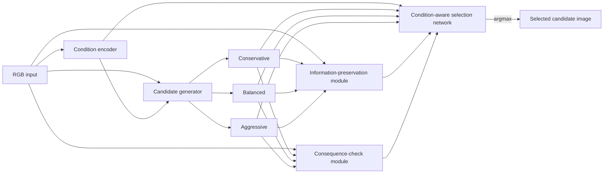

# Information-Preserving Adaptive Candidate Selection for Underwater Image Enhancement

This repository contains model implementations and research artifacts for paired underwater image enhancement. The V7 model produces three controlled enhancement candidates and applies an input-conditioned selector. V3 is a controlled fine-tuning experiment that updates the existing candidate generator and selector while holding the condition encoder and two measurement modules fixed.

The aim is to investigate whether adapting candidate generation and selection under the existing V7 objective changes the balance between reconstruction, preservation, consequence, and selection quality. The results below are validation-set findings. They do not establish improved downstream detection or classification.

## Project at a glance

- Dataset: paired EUVP Underwater ImageNet subset, expected at `data/EUVP/EUVP-Dataset/EUVP/Paired/underwater_imagenet/`.
- Manifests: `data/splits/train.txt`, `data/splits/val.txt`, and `data/splits/test.txt`; 2,960 / 370 / 370 pairs respectively.
- Frozen baseline: [original V7 epoch 19](checkpoints/v7/paper1_v7_best_epoch_019.pth).
- Selected fine-tuned model: [V3 best epoch 9](checkpoints/v7_enhancement_only_v3/paper1_v7_enhancement_only_v3_best_epoch_009.pth), selected from 20 completed epochs by minimum validation objective.
- Custom-image demo: [AquaEnhance V3](demo/aqua_enhance_v3/README.md).
- Reproducible Colab handoff: [V7 vs. V3 notebook](notebooks/Paper1_V7_vs_V3_Colab.ipynb).
- Exact weight comparison: [script](src/compare_v7_v3_weights.py) and [generated report](results/v7_v3_weight_comparison/WEIGHT_COMPARISON_REPORT.md).
- EUVP images are not distributed here. Obtain the dataset through its approved source and place it at the expected path before training or dataset evaluation.

## Research contribution and scope

The implemented model encodes an input image's condition, creates Conservative, Balanced, and Aggressive outputs, scores each candidate with a shared condition-aware utility network, and selects the highest-scoring candidate. V3 fine-tunes this existing system under the unchanged V7 objective. It adds no new refinement stage, detector, classifier, or task-supervision interface.

The contribution examined here is adaptive candidate selection with controlled candidate-generator fine-tuning. Future task-aware training would require approved task models, compatible differentiable interfaces or a justified feedback mechanism, aligned labels, and a separately approved evaluation protocol. Those components are not present in this experiment.

## Architecture

`Paper1ModelV7.forward` in `src/models/paper1_model_v7.py` defines the implementation:



The information-preservation and consequence-check modules provide fixed candidate measurements used by the selector and loss. In the V7 forward method their measurements run under `torch.no_grad()`. The selected image is the candidate tensor indexed by the selector's argmax; there is no separate final enhancement stage.

V3's actual training scope, confirmed by `src/train_v7_enhancement_only_v3.py`, is:

- **Trainable:** existing `candidate_generator` and `selection_network` (493,965 parameters).
- **Frozen:** `condition_encoder`, `information_preservation`, and `consequence_check`.

The checkpoint comparison confirms all frozen-module tensors are exactly identical to V7. A changed tensor alone does not prove trainability; the training script and pretraining audit establish that scope.

## Dataset and split boundaries

The paired dataset is read from `data/EUVP/EUVP-Dataset/EUVP/Paired/underwater_imagenet/` as `trainA`/`trainB` pairs. The split manifests contain:

| Split | Pairs | Role in this V3 experiment |
|---|---:|---|
| Train | 2,960 | Parameter updates only |
| Validation | 370 | Per-epoch monitoring and checkpoint selection |
| Test | 370 | Not used for V3 training, tuning, checkpoint selection, or the reported V7/V3 comparison |

The split identifiers are disjoint. The V3 preflight audited test-manifest identifiers for overlap, but did not load test images; its final evaluation and model comparison used validation pairs only. Do not use the held-out test split to tune or select new models. The existing `results/v7/v7_final_test_report.md` documents a separate historical frozen V7 test evaluation; those test results are not part of the V3 validation comparison.

## Checkpoint inventory

SHA-256 values below were checked against the files in this checkout. V7 remains the frozen original baseline; V3 does not replace it.

| Experiment | Checkpoint | Initialization / baseline | Best epoch | Training scope | SHA-256 | Report | Status |
|---|---|---|---:|---|---|---|---|
| Original V7 | `checkpoints/v7/paper1_v7_best_epoch_019.pth` | Original V7 run | 19 | Historical V7 selector training; frozen baseline for V1–V3 | `A0E04FEEC9A6C69CCEE0DD8A6E23E9C35227CDAA10C270DD82F853536920B49E` | [V7 training](results/v7/v7_training_report.md), [final test](results/v7/v7_final_test_report.md) | Frozen baseline; checkpoint is tracked in Git |
| Enhancement-only V1 | `checkpoints/v7_enhancement_only_v1/paper1_v7_enhancement_only_best_epoch_019.pth` | Original V7 | 19 | Selector only | `119A2C58DCC3274F0D87E19442A4B7CF41DDE48447C009E8BDA5AAA06186E502` | [V1 report](results/task_aware_v1/enhancement_only_v1/EXPERIMENT_REPORT.md), [comparison](results/task_aware_v1/enhancement_only_v1/BASELINE_VS_UPDATED_COMPARISON.md) | Preserved local experiment artifact; not required by V7/V3 notebook |
| Enhancement-only V2 | `checkpoints/v7_enhancement_only_v2/paper1_v7_enhancement_only_best_epoch_019.pth` | Original V7 | 19 | Selector only | `1822A9D11D80BB46C0D4EAD88BF64C1478E4B84A1C77D050046A9556625AA35D` | [V2 report](results/task_aware_v1/enhancement_only_v2/EXPERIMENT_REPORT.md), [comparison](results/task_aware_v1/enhancement_only_v2/BASELINE_VS_V1_V2.md) | Preserved local experiment artifact; not required by V7/V3 notebook |
| Controlled fine-tuning V3 | `checkpoints/v7_enhancement_only_v3/paper1_v7_enhancement_only_v3_best_epoch_009.pth` | Original V7 (not V1/V2) | **9** | Candidate generator and selector; remaining named modules frozen | `29F99549FBE2ED56ED9B56B4F3F4A34A82A6839AD0678D2F2A4DD91BD7A51EFA` | [V3 experiment](results/task_aware_v1/enhancement_only_v3/EXPERIMENT_REPORT.md), [integrity](results/task_aware_v1/enhancement_only_v3/CHECKPOINT_INTEGRITY_REPORT.md) | Selected V3 checkpoint; epoch 9 was minimum validation total across 20 completed epochs |

V1/V2 checkpoint weights and their full run artifacts remain preserved in the working project. Their experiment summaries and comparison reports are included for context, but the V7/V3 handoff does not distribute V1/V2 weights or load them in the Colab workflow.

## V3 training methodology

The verified configuration is recorded in `results/task_aware_v1/enhancement_only_v3/TUNING_CONFIGURATION.json`; the run record is in `TRAINING_LOG.csv` and `VALIDATION_COMPONENT_LOSSES.csv`.

- Initialization: original V7 epoch 19 weights; fresh Adam optimizer (no V1/V2 weights or optimizer state).
- Objective: `L_V7 = L_reconstruction + 0.2 × L_preservation + 0.2 × L_consequence + 0.5 × L_selection`, using unchanged `Paper1LossV7`.
- Optimizer: Adam, zero weight decay; candidate generator learning rate `1e-5`, selection network learning rate `5e-6`.
- Schedule: validation-total `ReduceLROnPlateau`, mode `min`, factor `0.5`, patience `2`, absolute threshold `1e-4`; per-group minimum rates `1.25e-6` and `6.25e-7`.
- Batch size 8; seed 42; 20 epochs; gradient norm clipped at 1.0.
- AMP: float16 GradScaler enabled when CUDA is available (initial scale 1024, growth interval 100,000, deterministic retry limit 6). This run recorded zero non-finite retries and no AMP interventions.
- Successful optimizer updates: 7,400. Best checkpoint: epoch 9 with validation total `0.180641507901`; training continued through epoch 20.
- Preprocessing: paired RGB tensors in `[0,1]`, no resize; paired horizontal flip with probability 0.5 in training and no validation augmentation.
- Checkpoint selection: lowest validation total under the unchanged V7 objective. No test images were loaded.

Epoch 9 is selected because it had the minimum validation objective, although all 20 configured epochs completed. The preservation component is an evaluation term on the generated outputs; the fixed measurement module itself was frozen.

## V7 versus V3 validation results

All metrics below are means on the same 370 validation pairs. The objective and component losses use unchanged `Paper1LossV7`; PSNR, SSIM, UIQM, and UCIQE use the canonical project metric implementation on RGB `[0,1]` arrays. Lower loss values are favorable; higher image-quality metrics are generally treated as favorable here. These validation means are not measurements for a custom upload.

| Metric | Original V7 | V3 | V3 − V7 |
|---|---:|---:|---:|
| Total V7 objective | 0.250245914749 | 0.180641507901 | −0.069604406848 |
| Reconstruction loss | 0.073375016733 | 0.058406659639 | −0.014968357094 |
| Preservation loss | 0.035322277228 | 0.052129711332 | **+0.016807434104 (regressed)** |
| Consequence loss | 0.077731877888 | 0.059971925375 | −0.017759952513 |
| Selection loss | 0.308520128049 | 0.199629042552 | −0.108891085497 |
| PSNR | 21.60594305 | 22.82398283 | +1.21803978 |
| SSIM | 0.79309426 | 0.81109402 | +0.01799977 |
| UIQM | 1.65974209 | 1.75147532 | +0.09173323 |
| UCIQE | 5.66041319 | 5.66623224 | +0.00581906 |

V3 improved the combined objective and all four reported validation image-quality means, while the preservation loss **worsened**. It is not a uniform improvement across loss components. UIQM/UCIQE are heuristics; they do not guarantee better human-perceived quality.

### V1/V2 context

The same report gives these validation means; V1/V2 are retained as context and are not used to initialize V3.

| Metric | V7 | V1 | V2 | V3 |
|---|---:|---:|---:|---:|
| Total objective | 0.250245914749 | 0.245716525413 | 0.252804185893 | 0.180641507901 |
| PSNR | 21.60594305 | 21.51331265 | 21.64381029 | 22.82398283 |
| SSIM | 0.79309426 | 0.79134396 | 0.79363146 | 0.81109402 |
| UIQM | 1.65974209 | 1.65661616 | 1.65826323 | 1.75147532 |
| UCIQE | 5.66041319 | 5.65138916 | 5.65893781 | 5.66623224 |

V1/V2 results were not uniform improvements: V1's four image-quality means were below V7; V2 improved PSNR/SSIM slightly but had lower UIQM/UCIQE and a higher total validation objective than V7.

## Custom-image evaluation with AquaEnhance V3

See [the AquaEnhance README](demo/aqua_enhance_v3/README.md) for the exact Windows commands and the two local environments used in this workspace. The app uses the V3 epoch-9 checkpoint and provides an original preview, before/after slider, selected output download, three actual candidate previews, selected candidate/selector probabilities, device and checkpoint details, and a per-upload metrics panel.

UIQM and UCIQE compare the uploaded RGB image with the actual selected V3 output. They are heuristic no-reference indicators; a positive change does not guarantee perceptual improvement. The optional reference upload enables PSNR/SSIM only after the user confirms paired alignment and color-space suitability and the EXIF-oriented RGB dimensions match exactly. The app never resizes a reference to create a score. Without a reference, PSNR/SSIM show `N/A — ground-truth reference required`. Validation-set values in the checkpoint information panel remain clearly labeled validation results and are not reused for the upload.

Some local custom-image examples showed mixed UIQM/UCIQE changes, and color-cast concerns remain a qualitative limitation. Image metrics do not settle perceptual quality; assess outputs visually and with appropriate paired references.

## Limitations and next steps

- V3 preservation loss regressed relative to V7.
- Custom images can have mixed UIQM/UCIQE changes; potential color casts require qualitative review.
- Detection loss, classification loss, and classification accuracy are **NOT EVALUATED**. Approved downstream task models, compatible interfaces, and aligned labels were unavailable.
- Visual changes and image-quality metrics do not establish downstream task improvements.
- A task-aware experiment needs valid task models, compatible differentiable interfaces or another justified feedback mechanism, aligned labels, and a predeclared evaluation protocol.
- The reported V7/V3 comparison is validation-only; the held-out test set remains outside V3 training and selection.

## Reproducibility and integrity

The V3 integrity report documents strict state-dictionary loading, repeated validation agreement, training/checkpoint metadata agreement, frozen module digests, and the unchanged V7/V1/V2 hashes. To rerun the V7/V3 weight audit from the project root with PyTorch available:

```powershell
python src/compare_v7_v3_weights.py
```

The script verifies both expected checkpoint hashes, loads separate `Paper1ModelV7` instances with `strict=True`, compares every parameter and buffer, and writes CSV/JSON/Markdown into `results/v7_v3_weight_comparison/`. It never writes to checkpoint paths. The current result reports 91 state tensors, 47 changed tensors, and 411,459 changed elements; all frozen modules are exactly identical. See [the weight comparison report](results/v7_v3_weight_comparison/WEIGHT_COMPARISON_REPORT.md).

For inference, use `eval()` and `torch.inference_mode()`, convert EXIF-oriented images to RGB float32 `[0,1]`, preserve dimensions, edge-pad only right/bottom to a multiple of 16, and crop model outputs back to the input size. V7 and V3 use the same preprocessing in the Colab notebook. Checkpoint paths, epochs, and hashes are listed above; do not overwrite original artifacts.

The original V7 checkpoint is already tracked. The selected V3 checkpoint is 12,047,106 bytes (under [GitHub's 100 MiB ordinary-Git per-file limit](https://docs.github.com/en/repositories/working-with-files/managing-large-files/about-large-files-on-github)) and is included directly; no Git LFS or external artifact host is required for these two files. V1/V2 checkpoint files and their reports remain in the local project but are not needed to run the V7/V3 notebook. EUVP images and uploaded-image data are not included.

## Historical V7 held-out test report

The separate original V7 final evaluation in `results/v7/v7_final_test_report.md` used 370 test pairs after its checkpoint was frozen. Its selected-output means were PSNR 21.2027 dB, SSIM 0.789558, UIQM 1.6703, and UCIQE 5.6111. V4 scored higher on PSNR/SSIM in that report, so V7 was not superior on every comparison. These results are retained as historical V7 evidence and must not be conflated with the V3 validation results above.

## Repository map

| Path | Purpose |
|---|---|
| `src/models/` | V3–V7 model and component implementations |
| `src/losses/` | Versioned losses, including unchanged `Paper1LossV7` |
| `src/train_v7_enhancement_only_v3.py` | Controlled V3 training entry point |
| `src/compare_v7_v3_weights.py` | Strict V7/V3 state comparison |
| `src/evaluate_test.py` | Canonical PSNR/SSIM/UIQM/UCIQE functions |
| `src/compute_v7_quality_metrics.py` | Canonical metric loader and batch evaluation utility |
| `data/splits/` | Train/validation/test filename manifests |
| `checkpoints/v7/` | Original frozen V7 checkpoints |
| `checkpoints/v7_enhancement_only_v1/` – `v3/` | Fine-tuning experiment checkpoints |
| `results/task_aware_v1/enhancement_only_v3/` | V3 config, logs, evaluation and integrity reports |
| `results/v7_v3_weight_comparison/` | Per-tensor CSV/JSON and report |
| `demo/aqua_enhance_v3/` | Local V3 inference app and verification docs |
| `notebooks/Paper1_V7_vs_V3_Colab.ipynb` | Colab inference, metrics, and weight comparison handoff |
| `Paper1_UIE_Colab.ipynb` | Earlier V7-only Colab handoff |
| `requirements.txt` | Existing pinned dependency record |

The EUVP dataset is excluded by `.gitignore`. The manuscript is not included in this checkout.

## Other project utilities and historical handoffs

The repository retains earlier experiments and local tools; interpret their results within each version's report rather than combining them with the V3 comparison.

- `src/models/` and `src/train_v3.py` through `src/train_v7.py` contain the historical V3–V7 implementations and training entry points. The separate controlled V3 fine-tuning script and its configuration are described above.
- `demo/app_v4.py` and `demo/app_v7.py` are historical local demos. The original V7 demo runs with `python demo/app_v7.py` at `http://127.0.0.1:7862`; it is distinct from the newer two-process AquaEnhance V3 app.
- The read-only dataset browser in `tools/dataset_viewer/` supports local paired-image browsing and representative-sample suggestions. From the repository root, run `python tools/dataset_viewer/server.py --host 127.0.0.1 --port 8765`; it expects EUVP at the path listed above.
- `docs/V7_MODEL_CARD.md`, `docs/preservation_method.md`, `PROJECT_AUDIT.md`, and `diagnostics/` retain the V7 model card, preservation method, project audit, and candidate/selector analyses.
- `Paper1_UIE_Colab.ipynb` is the earlier V7-only notebook; use `notebooks/Paper1_V7_vs_V3_Colab.ipynb` for the paired V7/V3 workflow in this handoff.

### Historical version map

| Version | Research role in the existing codebase |
|---|---|
| V3 | Preservation-oriented baseline; earlier model and demo are `src/models/paper1_model.py` and `demo/app.py`. |
| V4 | Candidate-specific Conservative/Balanced/Aggressive generation (`src/models/paper1_model_v4.py`, `demo/app_v4.py`). |
| V5 | Multi-objective candidate-selection experiment. |
| V6 | Fidelity-constrained selection experiment. |
| V7 | Condition-aware utility selection over the V4 candidate space (`src/models/paper1_model_v7.py`, `demo/app_v7.py`). |

These are historical experiment versions, and their reported results should be interpreted using each version's own protocol and report. This README's controlled fine-tuning V3 refers specifically to the V7-initialized experiment in `src/train_v7_enhancement_only_v3.py`, not the earlier base-model V3.

### Environment and dataset setup

The existing `requirements.txt` records package versions observed together with Python 3.12. For a local virtual environment, from the project root:

```powershell
py -3.12 -m venv .venv
.\.venv\Scripts\Activate.ps1
python -m pip install -r requirements.txt
```

If CUDA wheels are unavailable for the local platform, install a compatible PyTorch/torchvision pair using the official PyTorch selector, then install the remaining pinned dependencies. CPU inference is supported but slower. Colab should keep a compatible runtime-provided PyTorch build; the new V7/V3 notebook installs the pinned metric packages without replacing Colab's torch build.

The expected paired EUVP directory layout is:

```text
data/EUVP/EUVP-Dataset/EUVP/Paired/underwater_imagenet/
├── trainA/   # degraded input images
└── trainB/   # paired references
```

The dataset is intentionally ignored by Git. `src/data/create_splits.py` can create manifests for a new experiment; do not regenerate the frozen `data/splits/` files when reproducing reported results. The original V7 final-test evaluation command is `python src/evaluate_v7_final_test.py`; it reads the held-out test split and writes evaluation outputs, so it is not part of V3 training or checkpoint selection.

### Historical demos and dataset viewer

The older V4 and V7 demos can be run from the repository root:

```powershell
python demo/app_v4.py  # http://127.0.0.1:7861
python demo/app_v7.py  # http://127.0.0.1:7862
```

The V7 app displays candidates and selector information and includes optional reference metrics and a Figure 5 export workflow. These older demos are separate from [AquaEnhance V3](demo/aqua_enhance_v3/README.md), which uses the selected fine-tuned checkpoint and the two-process runtime described in its own README.

The local read-only dataset viewer browses matching `trainA`/`trainB` pairs, filename search, random browsing, pair selection, and heuristic representative-sample suggestions. Suggestions require human review; the viewer does not edit dataset files. From the repository root, run `python tools/dataset_viewer/server.py --host 127.0.0.1 --port 8765` and open `http://127.0.0.1:8765`. It requires the local EUVP directory but has no additional Python dependencies.

### Figures and paper artifacts

`tools/figures/` and `results/` contain generated figures, inference examples, and reports. Use their metadata to identify source images and checkpoint provenance; demo screenshots are interface illustrations, not substitutes for metric evaluation. The manuscript is not included in this checkout. `docs/V7_MODEL_CARD.md`, `docs/preservation_method.md`, `PROJECT_AUDIT.md`, and `diagnostics/` provide additional model, method, and selector-analysis context.

The V7 held-out test report remains frozen evidence. Do not use its test examples to tune V3 or future models.
